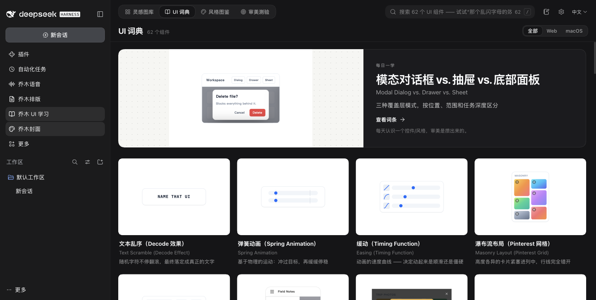

# Qiaomu UI Learn for DeepSeek Harness

Browse 13,561 design references, learn UI vocabulary through 106 interactive specimens, practice recognition quizzes, and keep your reviews as Markdown notes.

This port directly retains the [original Obsidian plugin](https://github.com/joeseesun/qiaomu-ui-learn) interfaces and product stylesheet. Only host containers, persistence, file access, shortcuts and Home integration are adapted.



Includes collections, recent designs, ratings/tags/comments, bilingual dictionary and styles, related-style navigation, quiz progress, source-aware recreation prompts, Markdown export, note drafts, JSON backups/imports, five native shortcuts, and optional Qiaomu Home cards/search.

## Install

Requires DeepSeek Harness 0.2.1-rc.3 (`>=0.2.1-rc.3 <0.3.0`). Download the prebuilt `.tgz` and `SHA256SUMS` from [Releases](https://github.com/joeseesun/qiaomu-ui-learn-dsh/releases). Verify the checksum, install the local bundle in Harness plugin management, and reload as prompted. Open **乔木 UI 学习** from the sidebar.

```sh
dsh plugin --profile YOUR_PROFILE add /absolute/path/qiaomu-ui-learn-dsh-0.1.0.tgz
```

Replace the profile and path with your own. No npm account or Obsidian installation is required. Home integration requires the `qiaomuHome` v1 service; the old Home 0.2.1 release does not yet provide it. This plugin also works independently.

## Data

Default state: `${DSH_HOME:-~/.dsh}/qiaomu/qiaomu-ui-learn-dsh/state.json`; Markdown: adjacent `notes/`. Configure absolute `dataDir` and `notesRoot` paths in the Host plugin configuration if needed. Profiles sharing DSH_HOME share the default plugin data; use `dataDir` to isolate them.

Import original Obsidian `data.json` through settings; existing Obsidian files are never modified automatically. An import downloads a backup before replacing learning records. Gallery thumbnails and previews load from Kombai; dictionary specimens are bundled. Note writes are confined to the configured directory and detect concurrent edits.

## Develop

```sh
npm ci
npm run check
npm pack
```

18 automated checks plus actual macOS Harness verification cover original views, persistence, shortcuts, Home integration, export/import, clipboard, themes and narrow layouts. See [the adaptation record](docs/ADAPTATION.md) for evidence and platform limits. Windows/Linux runtime behavior has not been verified on physical systems.

MIT plugin code; upstream content attribution and dependency licenses are retained in [THIRD_PARTY_NOTICES.md](THIRD_PARTY_NOTICES.md).

[中文](README.md)
