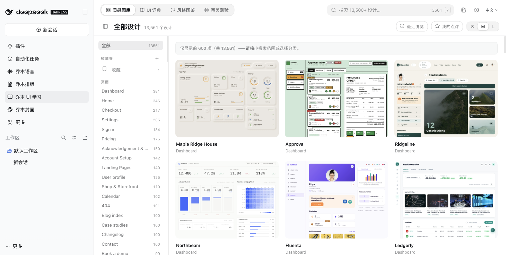

# 乔木 UI 学习 · DeepSeek Harness

在 DeepSeek Harness 里浏览设计参考、学习 UI 词汇、练习审美，并把自己的点评保存成 Markdown。

直接沿用 [Obsidian 版乔木 UI 学习](https://github.com/joeseesun/qiaomu-ui-learn) 的图库、词典、风格、测验、详情、收藏夹和设置界面，产品 CSS 保持一致。迁移仅替换宿主容器、文件保存、快捷操作和 Home 联动接口。



## 功能

- 13,561 条设计参考、184 个分类；搜索、收藏夹、最近浏览、点评筛选和卡片密度。
- UI 词典与风格图鉴：106 个交互标本、双语解释、识别特征、关联风格、代码与实现提示词。
- 审美测验：组件、风格或混合练习，键盘作答、掌握状态与复习记录。
- 五星评价、标签、评论；逐条或批量导出 Markdown，笔记浏览、光标插入和未保存草稿恢复。
- 原版设计灯箱、图片/Markdown/提示词复制、参考页面 HTML 源码读取。
- 导入 Obsidian `data.json` 或本插件备份；覆盖前下载现有记录备份。
- 5 个 Harness 原生快捷操作，可在宿主快捷键设置中绑定。
- 安装支持 v1 provider 服务的乔木 Home 后，提供最近设计卡片、浏览入口和全局设计搜索；没有 Home 时独立工作。


## 安装

要求 DeepSeek Harness **0.2.1-rc.3**（兼容声明 `>=0.2.1-rc.3 <0.3.0`）。从 [Releases](https://github.com/joeseesun/qiaomu-ui-learn-dsh/releases) 下载 `.tgz` 和 `SHA256SUMS`，核对摘要后，在 Harness 插件管理中安装本地 bundle。按宿主提示重载，然后从侧边栏打开「乔木 UI 学习」。

也可使用 Harness 自带 CLI 安装到指定 profile：

```sh
dsh plugin --profile YOUR_PROFILE add /absolute/path/qiaomu-ui-learn-dsh-0.1.0.tgz
```

`YOUR_PROFILE` 替换为自己的 profile。macOS App 自带 CLI 位于 `/Applications/DeepSeek Harness.app/Contents/Resources/runtime/cli/bin/dsh`。本项目交付预构建 GitHub Release 包，不需要 npm 账号或 Obsidian。

Home 联动需要提供 `qiaomuHome` v1 服务的版本；Home 0.2.1 的旧发布包尚无此接口。

## 数据与网络

默认学习记录位于 `${DSH_HOME:-~/.dsh}/qiaomu/qiaomu-ui-learn-dsh/state.json`，Markdown 位于同目录 `notes/`。Host 支持绝对路径配置 `dataDir`、`notesRoot`。现有 Obsidian 数据不会被自动修改；需要迁移时在设置中手动选择 JSON。不同 profile 使用同一 DSH_HOME 时默认共享该插件数据，可配置 `dataDir` 隔离。

图库缩略图与参考预览按需从 Kombai 加载；词典、风格与交互标本随包提供。源码下载限定公开参考目录、15 秒超时、2 MB 响应上限。笔记操作限制在所配置的目录内，写入校验版本，冲突时保留现有文件。

## 开发与验收

```sh
npm ci
npm run check
npm pack
```

18 项自动检查涵盖原版全部 106 详情的中英挂载、样式一致性、测验和点评逻辑、Home 协议、数据保存冲突、Markdown 路径保护及复制失败处理。真实 Harness 验收范围见 [适配对照](docs/ADAPTATION.md)。macOS Harness 的亮色、深色和 720px 窗口已验证；其他操作系统尚未实机验收。

## 来源与许可

插件 MIT；保留原仓库源码、作者署名和数据归属。设计目录及缩略图来自 Kombai Gallery；UI 学习内容通过 joeseesun/learnui 整理，原英文内容来自 namethatui.com。详见 [第三方声明](THIRD_PARTY_NOTICES.md)。

[English](README.en.md) · [源项目](https://github.com/joeseesun/qiaomu-ui-learn)
